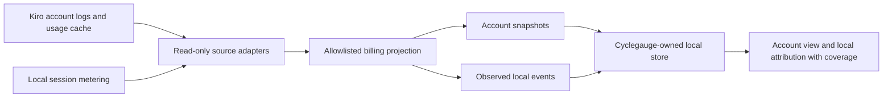

# Cyclegauge architecture

Status: version 0.5.1. Milestones 1–3, 4A–4C and 5 are implemented; the IDE extension reuses the log-only core and pure account history/forecast, cost and chart modules. Session aggregation, Crew integration and Kiro SQLite access remain deferred. [SPEC.md](SPEC.md) defines authority; [data findings](docs/kiro-data-format.md) distinguish evidence from assumptions.

## IDE extension boundary

`src/extension/extension.ts` adapts VS Code status bar, commands, webview and filesystem watcher APIs. `src/extension/controller.ts` calls the unchanged `collect`, `Store` and `view` core. This separates IDE UI from billing projection and storage. The bundle contains JavaScript and relies on Kiro's extension-host built-in Node modules, including `node:sqlite`; it does not spawn a separate Node process. The extension uses a change watcher with a 60-second polling fallback. Polling also recalculates freshness from the original observation time. Watcher events are hints, not evidence that account usage changed.

The detail webview has scripts disabled and a restrictive content security policy. Only allowlisted billing projections reach it. No raw log, identity, private source path or opaque deduplication key is displayed. The account store lives in the editor's per-extension storage folder (or a chosen location outside the source root), never among Kiro's logs or in the repository. CLI and Crew local per-turn metering are not extension inputs.

## Data flow and trust boundaries

Account snapshots determine current observed account usage. Local events explain some consumption by completion date. They are separate records and views; neither is added to the other. All components run locally. Milestone 1 uses TypeScript on Node.js 24.13+ with built-in SQLite, filesystem and crypto modules. Only account-response logs feed the implemented collector; cache/session arrows describe deferred adapters.

## Boundaries and proposed interfaces

- **Discovery:** platform-specific candidates plus an explicit root override. Check existence and access without starting Kiro. Do not traverse session source snapshots or follow symlinks outside a selected root.
- **Read-only adapters:** separate version/shape-aware adapters for `GetUsageLimitsCommand` log envelopes, notification cache JSON, IDE `usage_summary`, and CLI turn metadata. Adapter results are accepted projections or fixed diagnostic/status codes; raw records never leave the adapter.
- **AccountSnapshot:** device-local opaque account partition when continuity can be established, source kind, observed-at time with timestamp confidence, ingested-at time, resource type, precise usage/limit and supported overage fields, reset-at UTC, provenance, and quality flags. No raw envelope, identity, request data, or unknown arrays are retained.
- **LocalUsageEvent:** opaque local deduplication key, source/format, completion timestamp, credit amount only when interpretation is supported, and interpretation/coverage flags. Account association may be unknown; do not silently attach historical sessions to the currently logged-in account.
- **CoverageEvidence:** source availability, imported intervals, stale/ambiguous/conflicting data, missing metering, clock confidence, and reset evidence. No imported files does not mean zero usage.
- **Persistence:** a Cyclegauge-owned SQLite database in the editor's per-extension storage folder (`User/globalStorage/stefansuess.cyclegauge` beneath the editor's data root), as other extensions use; the CLI, which has no editor, defaults to the OS application-data directory. Never among Kiro's logs, in another Kiro-owned folder or in the repository. Store normalized billing observations, private opaque partition/deduplication keys, safe provenance tokens, and import cursors. Apply restrictive owner access/Windows ACLs; no raw records or private source paths. Keep any keyed pseudonymization secret device-local and outside diagnostics.

The implemented billing-only query is `view()` in `src/view.ts` and CLI `--json`; private `Store.snapshots()` is internal and must not be logged/exported. SQLite schema version 1 stores normalized account observations, private deduplication/account/source tokens and fixed-code import evidence. Local event/cache contracts remain proposed. See docs/usage.md and docs/privacy-and-storage.md for runtime commands and bounds.

## Account snapshot collection and reconciliation

Validate the command envelope and success metadata where available; extract only the `CREDIT` breakdown. A cache record is a derivative snapshot with its own stored timestamp. Source freshness takes precedence over a fixed log-versus-cache ranking. Equivalent observations may be coalesced; equal-time conflicting values remain a conflict and do not silently overwrite one another.

Prefer precise fields, with an explicit reduced-precision flag when falling back to integer fields. Preserve omitted fields as unknown. Exclude unsupported non-credit resources. Conflicting nested/outer reset dates must be flagged rather than silently accepted. Empty observed bonus arrays do not establish the schema or balance semantics of populated arrays.

Maintain account isolation. Logs contain identity fields, but the cache and session records cannot be assumed to carry sufficient account identity. Use only a narrowly projected identifier in memory to derive a private device-local partition where permitted; do not persist the identifier. If continuity or cache association cannot be established, isolate the observation and suspend cross-observation deltas rather than merge accounts.

An advancing reset timestamp with comparable observations supports a cycle change; a decrease without such evidence is an adjustment/anomaly. Do not subtract counters across cycles. Even after a detected reset, the old cycle's tail and new cycle's early daily distribution can remain unknown. A same-cycle positive difference is a net interval change, not proof of gross billable work or a complete daily series.

## Session interpretation and ingestion safety

IDE summaries provide local completion-time attribution. Deduplicate by stable opaque event identity; avoid counting a summary and a representation of the same turn twice. Multiple same-unit entries in a previously unseen summary shape require semantic validation before summing.

CLI `metering_usage[]` may contain additive entries or successive cumulative values. **Do not sum them until semantics are verified.** Establish this from authoritative implementation/documentation or a separately authorized controlled observation with stable turn identity and intermediate/final states. A monotonic list or agreement with one delayed account delta is insufficient. Record the verified version/shape and distinguish within-turn from between-turn accumulation. Until then, retain only a safe uninterpreted status. Repeated turn metadata is an upsert, not a new charge. No evidence currently proves cross-format deduplication.

Read text streams incrementally with bounded buffers; do not load arbitrary transcripts into error reporters. Accept only complete JSONL records, defer a partial trailing record, reject malformed records with fixed codes, and tolerate unknown fields without retaining them. Detect truncation, replacement, rotation, and out-of-order ingestion; checkpoints and deduplication must survive restarts. An overwritten session JSON must be parsed from a stable read or retried without logging its contents.

Kiro databases must never be copied, changed, or checkpointed. The investigation used `mode=ro&immutable=1` with no WAL present; immutable reads are not a proven live-database strategy. The first collector can operate from logs alone. Enable a cache database adapter only after tests prove no source/sidecar writes and correct handling of concurrent writers; otherwise report the cache unavailable. Do not use `query_only` as the sole write safeguard or ignore WAL contents as if current.

## Cross-platform design and verification matrix

| Target | Candidate IDE root | Candidate CLI database | Evidence / required validation |
| --- | --- | --- | --- |
| macOS | `~/Library/Application Support/Kiro` | `~/Library/Application Support/kiro-cli/data.sqlite3` | Kiro 1.2.37 paths/shapes observed; synthetic collector tests pass; live VSIX status/detail verified in Kiro 1.2.56 |
| Windows | `%APPDATA%\Kiro` | Discover or configure explicitly; no verified default | IDE root and `logs/<timestamp>/window1/exthost/kiro.kiroAgent/q-client` observed by the maintainer on 2026-10-14 (extension hidden by Explorer); native Kiro behaviour unverified; owner-only local NTFS storage implemented; test native/WSL separation, NTFS replacement/sharing, ACLs, drive/UNC paths, case and Unicode |
| Ubuntu | `${XDG_CONFIG_HOME:-~/.config}/Kiro` | `${XDG_DATA_HOME:-~/.local/share}/kiro-cli/data.sqlite3` | IDE root `~/.config/Kiro` and `logs/<timestamp>/window1/exthost/kiro.kiroAgent/q-client.log` observed by the maintainer on 2026-10-14; CLI database path still inferred; test XDG overrides, permissions, atomic rename, watch behavior, packaging |
| RHEL | Same XDG candidates as Ubuntu | Same inferred XDG candidate | Unverified independently of Ubuntu; test supported versions, dependencies, SELinux denials, and filesystem behavior |

`~/.kiro/sessions` is observed on macOS; treat it as a candidate elsewhere, not a guarantee. Support explicit roots and separate source instances for multiple installations, containers, remote homes, and WSL. Do not merge host and guest histories implicitly. Record source timezone assumptions for offset-free logs; travel and DST can make historical timestamps ambiguous. Local days may last 23 or 25 hours; billing reset timestamps remain UTC.

Windows/Linux native release acceptance remains pending; see [platform verification](docs/platform-verification.md) for the automated host checks. Alternate account adapters remain deferred. The current package targets the local Kiro IDE extension host; VSIX installation alone does not validate those other platforms.

## Implemented Milestone 1 decisions

- `src/source.ts`: depth-constrained log discovery, explicit read-only file descriptors, no symlinks, bounded lines/files and stable metadata checks around reads. An unstable file yields no projections. No source SQLite connection is ever created.
- `src/projection.ts` and `src/time.ts`: command/success validation, exact JSON numeric lexical tokens via the Node reviver context, CREDIT allowlist and declared timezone/DST handling. Raw parsed envelopes remain transient; only userId is narrowly projected in memory for partitioning. Original validated timestamp spelling/offset is retained alongside UTC instants.
- `src/store.ts`: owner-only app directory/key/database, HMAC tokens, per-source import transactions, durable deduplication, private source fingerprints/lengths and fixed-code evidence. Persisted projections are revalidated before querying. On Windows the default profile location relies on profile permissions; a chosen location uses verified owner-only NTFS DACLs via built-in Windows PowerShell/.NET; unavailable or unsafe ACLs fail closed.
- `src/collector.ts`: full bounded rescans replace optimized cursors in this small implementation. This prevents missed same-size replacements; fingerprints and lengths retain source-change evidence. Unknown interval consumption remains unknown.
- `src/decimal.ts` and `src/view.ts`: decimal strings/BigInt arithmetic, freshness/conflict/account isolation, conservative interval classification and explicit allocation, plus independent Milestone 3 history/forecast modules.
- `src/cli.ts`: local text/JSON query, fixed errors and no private identity/path diagnostic output. No live watcher, automatic migration, pruning or account selector.

Read stability checks detect ordinary concurrent writes/replacement; they do not claim a filesystem snapshot or protection against a malicious local actor able to swap ancestors/metadata during a read. Symlink checks and file identity comparisons fail closed on detected escapes. Restrictive storage permissions protect against other users on verified POSIX filesystem behavior; Windows DACL enforcement and native acceptance are tracked in [platform verification](docs/platform-verification.md).

## Milestone 3 core and future optimizer boundary

Implemented flow: read-only log collector → existing owned Store → `history(StoredSnapshot[])` → `forecast(AccountHistory, now, maxAgeHours)` → `view()` → CLI JSON / extension controller. The controller displays only billing/quality results; core modules import no VS Code APIs. Store schema remains version 1. `history` strips private account/deduplication/source keys before returning anything public, keeps conflicts and quality barriers, and reports interval/day coverage. `forecast` returns versioned policy, CREDIT units, observation anchor, explicit reset/horizon, current usage/limit, remaining base capacity, daily budget, independently qualified method results, windows, rates and comparison reasons. Its contract is suitable for a later cost-engine adapter without pricing logic in the forecast core.

Forecast methods use original decimal changes and integer durations. Rolling boundaries must be observed exactly; no interpolation or fabricated daily allocation. Clean-window selection restarts after gaps/adjustments/limit changes, and cannot rehabilitate the cycle-wide method without a new comparable cycle. Schema/policy v2 returns a `tier` on the forecast and method estimates instead of `confidence`. `observed_window` qualifies as provisional after three comparable snapshots and 48 hours; all regular methods preserve eight snapshots/seven days. Selection always prefers an eligible regular method. Both tiers share 36-hour maximum gaps, freshness, stable billing/continuity and anomaly gates. The controller labels provisional, regular and unavailable states and explains the selected window and limited history. No probability or confidence interval is asserted. SPEC.md defines formulas, eligibility thresholds and safe unavailable states.

Future architecture adds two independent consumers, not collectors hidden inside forecasts:

- **Cost scenarios:** validated versioned `PricingCatalog` + explicit billing profile + allowlisted `PurchasedCreditLot` balances/expiry + credit forecast contract → `CostScenario` for keep/upgrade/downgrade/packs/existing capacity, with 1/3/6-month expenditure/savings, baseline, effective timing, currency, taxes and quality. Separate observed invoice/purchase evidence from modeled spending. Catalog contains provenance/effective dates, limits/fees/purchase increments, rollover/expiry/priority and transition/proration rules. Enterprise overage/cap policy is separate from consumer prepaid packs. Unknown balances/pricing/terms withhold applicable recommendations. No purchases, network calls or subscription mutation are authorized by this design.
- **Efficiency insights:** separately reviewed metadata adapters → validated session/turn/model/workflow aggregates with coverage → evidence-based comparisons. Metrics alone do not measure successful outcomes or establish waste. No content extraction. Session collectors/semantic validation remain future gates.

These names describe future contracts, not implemented interfaces. New metadata needs explicit allowlists and tests before acquisition; production raw data cannot become fixtures. Content analysis requires separate explicit privacy/security design review and opt-in authorization, with no weakening of AGENTS.md. Dated public rules and unresolved local balance interpretation are in [cost optimizer roadmap](docs/cost-optimizer-roadmap.md).

The UI-only `src/extension/presentation.ts` converts the billing-only view contract into concise status text, a plain tooltip, warning state and themed, responsive HTML. The controller still owns collection/refresh and the native extension owns status-bar/webview lifecycles. Presentation changes do not modify core forecast logic or public CLI contracts. Budget summaries truncate to one decimal; exact values remain in tooltips/details. Native status order uses right alignment and priority, with no guaranteed adjacency to Kiro's indicator.

## Milestone 4 engine and extension boundaries

The [M4 design](docs/cost-optimizer-roadmap.md) implements six small pure core modules under `src/cost/`: contracts, catalog validation, exact amounts, demand adaptation, single-strategy simulation and comparison. Validation and limitations are recorded in [M4A checkpoint](docs/milestone-4a-validation.md). Only qualified public forecast/history projections and explicit manual billing inputs enter the engine; it imports no VS Code, storage or network APIs. Existing displayed six-decimal rates are not exact purchase inputs: the adapter reconstructs the selected eligible method's rational rate from its supported history endpoints.

The Milestone 4B controller supplies session-only profile inputs through `CostInputs`, bound internally to the existing private account partition and cleared on account context changes/ambiguity. Monotonic editor tickets reject late or superseded completions. Only allowlisted billing values reach the engine or renderer; opaque keys never reach HTML or diagnostics. Native configure/edit/clear commands use QuickPick/InputBox; `cost-presentation.ts` augments the script-disabled details. The panel has native editor-title actions and a local anchor jump link. `calculateCosts` revalidates demand separately for 1/3/6 cycles. `optimizeCosts` calls the bounded analytical-reference API, never exhaustive enumeration; tree shaking excludes `findBreakEven` and its cache from the shipped extension. No worker infrastructure was necessary. The collector, Store schema, CLI contract and forecast policy remain unchanged. Failure of the optional optimizer leaves the existing budget view usable.

Pricing is bundled reviewed data with rule-level provenance and explicit unknowns. Consumer prepaid lots and Enterprise postpaid liabilities use separate rules. Catalog, simulation and result versions are explicit; no runtime network update or inference of eligibility. Before-reset bridge and full future cycles have separate accounting. The [M5 chart](docs/milestone-5-visual-dashboard.md) (0.5.0) is a pure transform (`src/extension/chart-model.ts`) plus a separate inline-SVG renderer (`src/extension/chart.ts`); it adds no runtime dependency, webview script or permission.

## Milestone 4A approval — 2026-10-10 (historical)

The user approved Tasks 1–4 of the existing Milestone 4 plan. Implement the independent billing-only cost engine with exact arithmetic and explicit hypothetical manual comparisons, without requiring forecast history or a fully known account profile. Unknown billing rules remain gates; any standalone zero-inventory/promotion-excluded scenario must be explicitly declared. Collector, Store, CLI, forecast policy and UI remain unchanged. Milestone 4B/5 and automatic commits are excluded. Stop after engine validation for review.

## Milestone 4B approval — 2026-10-10 (historical)

M4A was accepted; Task 5 and responsive ordinary comparisons are approved and implemented. This supersedes the previous M4A-only checkpoint boundary. See [M4B validation](docs/milestone-4b-validation.md). Milestone 5 was approved and implemented later (0.5.0, see above); session aggregation, Crew integration and Kiro SQLite access remain outside scope.

## Milestone 4C data flow

`Store.snapshots()` (unchanged; all retained snapshots per account partition) → `history()` groups equal-time observations, keeps the existing current-cycle view and adds `evidence` (cross-cycle, billing-only, trailing 85 UTC days, regime stops and local exclusions) → `forecast()` computes the three existing methods unchanged plus exposure-weighted pooled `history_*` estimates and qualifiers → presentation text and `buildDemand()`, which re-runs `forecast()` with the policy's heuristic switches and compares the exact evidence before using it. No new persistence, schema migration, source or authenticated call is introduced. `tests/unit/baseline/` holds a frozen v0.4.0 copy used only by the walk-forward backtest.

## 0.5.2 Advisor presentation boundary

`src/cost/advisor.ts` builds conditional engine inputs; `src/cost/estimate.ts` reads exact engine results over matched full cycles. Neither accesses storage, VS Code or networks. `AdvisorInputs` binds session-only answers to the existing private account partition, clearing on account change or ambiguity and rejecting late editors. Native commands invoke the script-free renderer; the detail view stays script-free and enables command links only for `cyclegauge.costAdvisor`, `cyclegauge.auditWorkspace` and `cyclegauge.audit.show` through the webview command allowlist.
