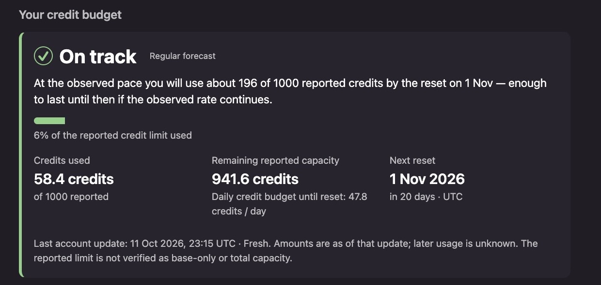
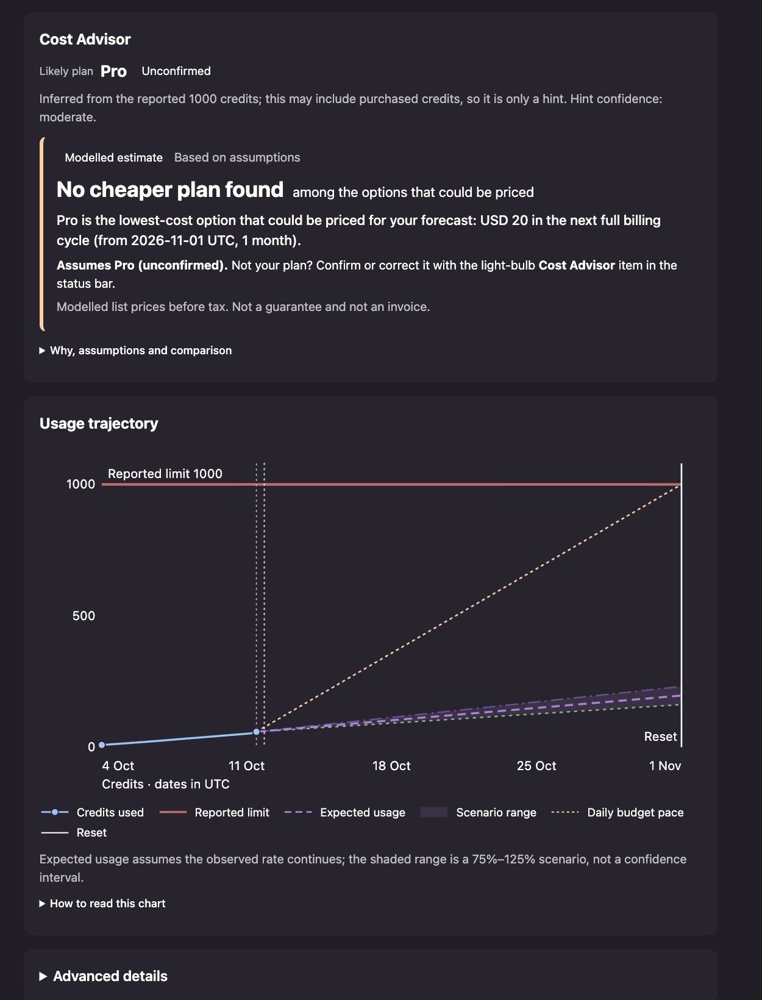

# Cyclegauge for Kiro IDE

**Credit usage & forecasting for Kiro IDE**

Know how many AI credits you've used, how many remain, and whether they'll last until your next reset.

Cyclegauge adds a status-bar item and a detail view to Kiro IDE. It reads Kiro's local usage logs, needs no separate sign-in, and sends nothing anywhere.

  

Cost Advisor and usage trajectory

  

The plan hint is unconfirmed and the estimate is conditional, modelled, and before tax. It is not a guaranteed saving or an invoice. Unknown purchase or billing rules are not filled in.

> Unofficial open-source project. Not affiliated with, endorsed by or sponsored by Amazon Web Services or Kiro. "Kiro" is a trademark of its owner.

## Features

- **Status bar at a glance:** your daily credit budget and forecast outlook (collecting data, provisional, on track, at risk, likely to exceed, stale or unavailable).
- **Detail view:** credits used, remaining reported capacity, daily budget, next reset and how fresh the data is.
- **Usage trajectory chart:** observed usage, the reported limit, the reset, and (when there is enough history) scenario lines. Unknown periods are hatched, never filled with zero. Accessible text and a data table accompany the chart.
- **Qualified forecasts:** a provisional estimate (at least 3 comparable snapshots over 48 hours) and a regular forecast (8 snapshots over 7 days), both needing fresh data without long gaps. They are labeled scenarios, not guarantees.
- **Cost Advisor:** automatic conditional plan comparisons from your forecast, with session-only answers. Numerical estimates show modelled pre-tax USD list-price differences for the next full billing cycle; 1/3/6-cycle details and hypothetical 75/100/125% usage sensitivity stay expandable. Plan hints are unconfirmed, and estimates are not guaranteed savings or invoices. Use **Cyclegauge: Cost Advisor** or the lightbulb status item while the detail view is open.
- **Command-line tool:** print the same figures in a terminal, optionally as JSON.

## Install

Cyclegauge is a **macOS beta** for Kiro IDE (extension ID `StefanSuess.cyclegauge`).

1. Install from the [Open VSX listing](https://open-vsx.org/extension/StefanSuess/cyclegauge), or in Kiro run **Extensions: Install from VSIX...** and select a downloaded Cyclegauge `.vsix` file.
2. Reload the window if Kiro asks.
3. Click the status-bar item, or run **Cyclegauge: Show Account Credits**, to open the detail view.

It shows "Collecting data" until Kiro has written account usage to its logs and a few observations have been recorded. Your daily budget is available from the first fresh account update in the tooltip and the detail view. Settings, the CLI and troubleshooting notes are in the [usage guide](https://github.com/StefanSuess/Cyclegauge/blob/HEAD/docs/usage.md).

**Coming from EasyKiroGauge?** Cyclegauge is a different extension, so Kiro does not upgrade the old one. Install Cyclegauge, then disable or uninstall EasyKiroGauge and reload. While both are enabled, Cyclegauge pauses itself. Your history stays in place. Details: [identity migration](https://github.com/StefanSuess/Cyclegauge/blob/HEAD/docs/identity-migration.md).

To build from source you need Node.js 24.13 or newer and [pnpm](https://pnpm.io): `pnpm install --frozen-lockfile && pnpm package:vsix`, then install the file from `dist/`.

## Privacy

- **Read-only.** Kiro's files and databases are never modified. Cyclegauge does not run Kiro commands or call Kiro services.
- **Local only.** No telemetry and no network code. Derived numbers are kept in the extension's own private directory.
- **Minimal data.** Each complete log line is parsed briefly in memory, but only allowlisted billing fields are extracted and stored. Prompts, code, conversations, tool data and credentials are dropped after parsing and never stored or shown. Raw account identifiers are not stored; a device-local key is used to tell accounts apart.
- **Script-free view.** The detail view runs no scripts.

Details: [privacy and storage](https://github.com/StefanSuess/Cyclegauge/blob/HEAD/docs/privacy-and-storage.md). Never post real Kiro data in issues or pull requests.

## Platform support and limitations

| Platform | Status |
| --- | --- |
| macOS | Beta; maintainer-reported synthetic-data testing (Kiro 1.2.56) |
| Ubuntu | Unverified |
| RHEL | Unverified, best effort; not an officially supported Kiro platform |
| Windows | Unverified; storage is deliberately disabled for now |

Figures are the last values Kiro logged, shown with an as-of time. They are not a live balance. Kiro's log format is not a documented contract and may change. More in [platform support and limitations](https://github.com/StefanSuess/Cyclegauge/blob/HEAD/docs/platform-support.md).

## Documentation and project

- [Documentation index](https://github.com/StefanSuess/Cyclegauge/blob/HEAD/docs/README.md): usage, calculations, forecasting, chart, privacy, architecture
- [Contributing](https://github.com/StefanSuess/Cyclegauge/blob/HEAD/CONTRIBUTING.md) and [security policy](https://github.com/StefanSuess/Cyclegauge/blob/HEAD/SECURITY.md)
- [Changelog](https://github.com/StefanSuess/Cyclegauge/blob/HEAD/CHANGELOG.md)
- [Roadmap](https://github.com/StefanSuess/Cyclegauge/blob/HEAD/ROADMAP.md) and [version history](https://github.com/StefanSuess/Cyclegauge/blob/HEAD/docs/version-history.md)

## License

[MIT](https://github.com/StefanSuess/Cyclegauge/blob/HEAD/LICENSE)
